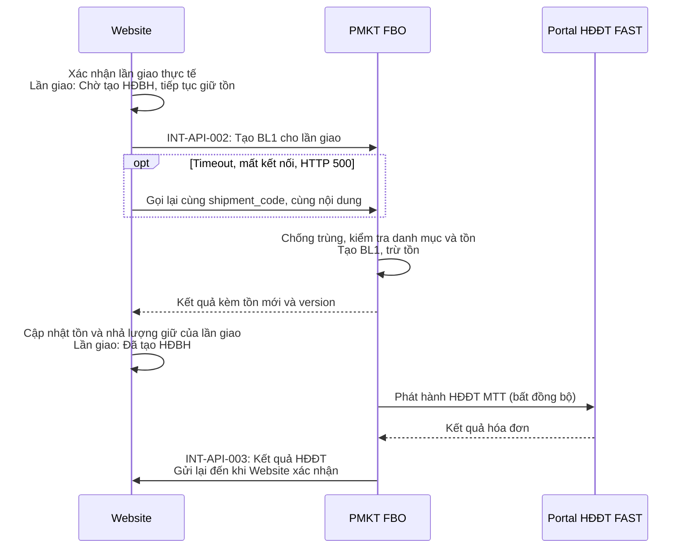

# Yêu cầu, giải pháp và API cơ bản - Website Phương Thảo / FBO

Ngày cập nhật: 17/10/2026. Cơ sở: BRD PT-BRD-001 phiên bản 1.5 và SRS PT-SRS-001 phiên bản 1.1.

Tài liệu tóm tắt để thống nhất giải pháp giữa Phương Thảo, đội Website và FBO. Đặc tả chi tiết trường, mã lỗi, HTTP status và xử lý nằm trong SRS; bản này thay thế bản ngày 08/10/2026 (bỏ INT-API-005, `request_id` và khái niệm "lượng đã giao chưa phản ánh trong tồn").

## 1. Yêu cầu

| Yêu cầu | Tham chiếu BRD |
|---|---|
| Nhận tồn thực tế từ FBO qua phản hồi tạo HĐBH/hoàn và job 5 phút, kèm phiên bản tồn; tính/hiển thị tồn khả dụng | INV-BR-001, INV-BR-002, INT-BRU-003 |
| Đã xác nhận: khách đã thanh toán, chưa giao. Hoàn thành 1 phần: đã giao một phần. Hoàn thành: đã giao toàn bộ | ORD-BR-007, ORD-BRU-007 |
| Giữ phần chưa giao của đơn Đã xác nhận, Hoàn thành 1 phần và lượng của các lần giao Chờ tạo HĐBH | INV-BRU-002, INV-BRU-003 |
| Mỗi lần giao gọi FBO tạo HĐBH, trừ tồn và phát hành HĐĐT MTT cho riêng lượng/giá trị lần giao | ORD-BR-003, INVH-BR-001 |
| Hoàn hàng chỉ rõ lần giao/dòng giao; FBO nhập lại kho bán của bộ phận và điều chỉnh đúng HĐĐT gốc | ORD-BR-005, INV-BR-003, INVH-BR-002 |
| Website phân bổ giá trị, chiết khấu; FBO dùng nguyên số liệu và tính thuế theo cấu hình | ORD-BR-009, ORD-BRU-009 |
| Không xử lý trùng khi gửi lại; gọi bù qua hàng đợi retry đến khi thành công | INT-BR-001, INT-BR-004, INT-BRU-004 |

Xác nhận thanh toán do Website đã có xử lý. Cơ chế thanh toán và thực hiện hoàn tiền không thuộc phạm vi tích hợp.

## 2. Giải pháp

### 2.1. Mô hình đơn, lần giao và lần hoàn

**Một đơn → nhiều lần giao → mỗi lần giao một HĐBH (BL1) và HĐĐT MTT → mỗi lần hoàn (TL1) tham chiếu một lần giao và HĐĐT gốc tương ứng.**

| Đối tượng | Mã và thông tin liên kết |
|---|---|
| Đơn | `order_code`, dòng đơn `order_line_id` |
| Lần giao | `shipment_code` (= số chứng từ BL1 trên FBO); dòng giao `shipment_line_id` trỏ về `order_line_id` |
| Lần hoàn | `return_code` (= số chứng từ TL1 trên FBO), `shipment_code` của lần giao được hoàn; dòng hoàn trỏ `shipment_line_id` |
| HĐĐT | HĐĐT MTT của BL1; HĐĐT điều chỉnh giảm của TL1 tham chiếu HĐĐT của BL1 gốc |

Ví dụ đơn D001 có 10 áo: G001 giao 4 → hóa đơn 1; G002 giao 6 → hóa đơn 2. Hoàn 2 áo thuộc G001 chỉ điều chỉnh hóa đơn 1. Nếu trả cả hàng G001 và G002, tách thành hai yêu cầu hoàn.

### 2.2. Tồn kho và giữ hàng

**Tồn khả dụng = Tồn thực tế FBO - Tồn bị giữ.**

**Tồn bị giữ = Lượng chưa giao của đơn Đã xác nhận và Hoàn thành 1 phần + Lượng của các lần giao Chờ tạo HĐBH.**

Khi giao Q, lượng Q chuyển từ phần chưa giao sang phần chờ tạo HĐBH nên tổng giữ không đổi. Khi FBO phản hồi tạo HĐBH thành công kèm tồn mới, Website cập nhật tồn và nhả Q trong cùng một lần xử lý.

| Sự kiện (tồn ban đầu 100, đơn 10 áo) | Tồn bị giữ | Tồn FBO | Khả dụng |
|---|---:|---:|---:|
| Xác nhận | 10 | 100 | 90 |
| Giao G001: 4 áo, Chờ tạo HĐBH | 10 | 100 | 90 |
| FBO tạo BL1 G001, trả tồn 96 | 6 | 96 | 90 |
| Giao G002: 6 áo, FBO trả tồn 90 | 0 | 90 | 90 |
| Hoàn 2 áo G001, FBO trả tồn 92 | 0 | 92 | 92 |

FBO cập nhật tồn cho Website qua ba đường: response INT-API-002/004, job 5 phút cho các mặt hàng có biến động và đẩy toàn bộ khi bật đồng bộ/go-live/đối soát. Mỗi bản tồn có `version` (epoch ms, thời điểm bắt đầu đọc tồn đã commit); Website bỏ qua bản có `version` cũ hơn bản đang dùng.

Phạm vi tồn: Mã kho bán của các bộ phận đang sử dụng và đã tick Đồng bộ web trong Danh mục bộ phận FBO.

### 2.3. Giao hàng và tạo hóa đơn theo lần giao



FBO từ chối cả yêu cầu nếu một mã hàng không đủ tồn (`INSUFFICIENT_STOCK`, kèm tồn hiện tại); Website xử lý trường hợp này. Lỗi HĐĐT không làm tạo lại BL1 hay trừ tồn lại; người dùng FBO tự xử lý rồi phát hành lại.

### 2.4. Hoàn hàng theo lần giao và HĐĐT gốc

```mermaid
sequenceDiagram
    actor KH as Khách hàng
    participant WEB as Website
    participant FBO as PMKT FBO
    participant PORTAL as Portal HĐĐT FAST
    KH->>WEB: Hoàn hàng thuộc lần giao cụ thể
    WEB->>WEB: Chỉ gửi khi lần giao đã Đã tạo HĐBH
    WEB->>FBO: INT-API-004: Mã hoàn, mã lần giao, dòng giao, lượng và giá trị hoàn
    FBO->>FBO: Kiểm tra lượng/giá trị hoàn lũy kế theo dòng giao<br/>Tạo TL1, nhập lại Mã kho bán của bộ phận
    FBO-->>WEB: Kết quả kèm tồn mới và version
    alt HĐĐT gốc đã xác thực
        FBO->>PORTAL: Phát hành HĐĐT điều chỉnh giảm
    else HĐĐT gốc chưa xác thực
        Note over FBO: TL1 chờ; khi HĐĐT gốc phát hành thành công<br/>FBO tự phát hành HĐĐT điều chỉnh
    end
    PORTAL-->>FBO: Kết quả hóa đơn điều chỉnh
    FBO->>WEB: INT-API-003: Kết quả HĐĐT điều chỉnh<br/>Gửi lại đến khi Website xác nhận
```

Hủy phần chưa giao không gọi FBO: Website chỉ nhả lượng giữ, không nhập lại tồn hay điều chỉnh hóa đơn.

## 3. Danh sách API

Quy ước chung: `Content-Type: application/json`, `Authorization: Bearer <token>`. Token không hết hạn, cấp một lần qua chat và cấp lại qua chat khi thay đổi. Response gồm `success`, `error_code`, `error_message` (lý do lỗi cụ thể), `data`.

| Mã | Tên | Bên cung cấp | Bên gọi | URL | Điểm chính |
|---|---|---|---|---|---|
| INT-API-001 | Cập nhật tồn | Website | FBO | Website định nghĩa | Mỗi dòng: mã kho, mã hàng, số tồn thay thế, `version`. Batch tối đa 500 dòng; gửi lỗi thì chu kỳ sau tự gửi lại |
| INT-API-002 | Tạo hóa đơn bán lẻ theo lần giao | FBO | Website | `{FBO_BASE_URL}/api/v1/integration/shipments/sales` | Chống trùng theo `shipment_code`; kiểm tra tồn theo mã hàng; response kèm tồn mới. Đặc tả cho Website: `API_Tao_hoa_don_ban_le.md` |
| INT-API-003 | Kết quả HĐĐT | Website | FBO | Website định nghĩa | Dùng chung cho HĐĐT của BL1 và HĐĐT điều chỉnh của TL1; gửi ngay khi phát hành thành công, xếp cuối hàng đợi và gửi lại đến khi Website xác nhận |
| INT-API-004 | Hoàn hàng theo lần giao | FBO | Website | `{FBO_BASE_URL}/api/v1/integration/returns` | Chống trùng theo `return_code`; một lần giao mỗi yêu cầu; response kèm tồn mới và trạng thái HĐĐT điều chỉnh (`PENDING` / `WAITING_ORIGINAL`) |

Chi tiết trường, mã lỗi, HTTP status, giới hạn và mapping chứng từ: xem SRS mục 2 đến 7.
