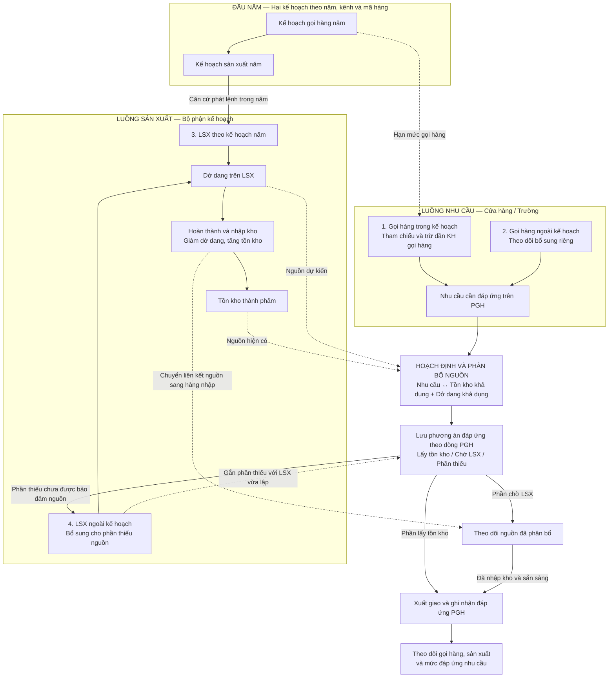

# Mô hình liên kết kế hoạch nhu cầu và nguồn cung sản xuất

Mô hình nghiệp vụ theo mô tả stakeholder ngày 22/10/2026. Mục tiêu là nhìn thấy việc gọi hàng và sản xuất vận hành trong cùng một hệ thống. Đây là mô hình yêu cầu và nguyên tắc kiểm soát đề xuất; không phải xác nhận toàn bộ quy tắc đã được FBO triển khai.

## 1. Cấu trúc mô hình

Sử dụng **hai luồng song song, kết nối qua hoạch định và phân bổ nguồn**:

- Luồng nhu cầu: Kế hoạch gọi hàng năm → PGH theo kế hoạch hoặc PGH bổ sung → nhu cầu cần đáp ứng.
- Luồng nguồn cung: Kế hoạch sản xuất năm → LSX theo kế hoạch; hoặc thiếu nguồn khi hoạch định → LSX bổ sung. Khi thực hiện, LSX tạo dở dang; khi hoàn thành, dở dang chuyển thành tồn kho.
- Điểm kết nối: Mỗi dòng PGH được liên kết tới lượng tồn kho được phân bổ hoặc lượng dở dang trên LSX được phân bổ. Phần chưa được đáp ứng mới tạo nhu cầu sản xuất bổ sung.

**Loại PGH và loại LSX là hai chiều độc lập.** PGH ngoài kế hoạch có thể lấy từ nguồn sản xuất theo kế hoạch còn khả dụng. PGH trong kế hoạch vẫn có thể cần LSX bổ sung nếu nguồn hiện có không đủ. Cả hai loại PGH đều đi qua cùng bước hoạch định.

## 2. Sơ đồ vận hành chung

Đường liền thể hiện trình tự hoạt động; đường nét đứt thể hiện tham chiếu, cung cấp dữ liệu hoặc cập nhật liên kết nguồn. Liên kết hai kế hoạch thể hiện lập kế hoạch SX sau kế hoạch gọi hàng; không mặc định công thức tính hay số lượng bằng nhau. Xuất giao là bước nghiệp vụ để khép kín đáp ứng PGH, chưa xác định chứng từ FBO cụ thể trong phạm vi mô hình này.

## 3. Bốn tình huống đi qua cùng hệ quy trình

| Tình huống | Kế hoạch liên quan | Cách xử lý chung |
|---|---|---|
| 1. Gọi hàng trong kế hoạch | Trừ dần kế hoạch gọi hàng năm | Hoạch định trên tồn kho và dở dang còn khả dụng. Có đủ thì phân bổ; thiếu thì lập LSX bổ sung cho phần thiếu. |
| 2. Gọi hàng ngoài kế hoạch | Không tiêu dùng hạn mức gọi hàng năm | Vẫn hoạch định trên cùng nguồn còn khả dụng. Không mặc định phải tạo LSX mới chỉ vì PGH là bổ sung. |
| 3. Sản xuất theo kế hoạch | LSX tham chiếu kế hoạch sản xuất năm | Có thể phát lệnh trước PGH. Dở dang và thành phẩm sau nhập kho trở thành nguồn để hoạch định PGH. |
| 4. Sản xuất ngoài kế hoạch | LSX bổ sung liên kết phần thiếu khi hoạch định | Chỉ lập cho phần chưa được bảo đảm nguồn; khi lập phải gắn lại nhu cầu để lần hoạch định sau không tiếp tục đề nghị cùng phần thiếu. |

Với phạm vi stakeholder hiện cung cấp, sản xuất ngoài kế hoạch là LSX bổ sung do thiếu nguồn. Chưa mở rộng sang sản xuất đầu cơ hoặc bổ sung tồn chủ động ngoài kế hoạch khi chưa có PGH.

## 4. Ma trận kết hợp nhu cầu và nguồn sản xuất

| Nhu cầu gọi hàng | Nguồn từ SX theo kế hoạch | Nguồn từ SX bổ sung |
|---|---|---|
| Trong kế hoạch | Trường hợp thường gặp: tận dụng tồn kho hoặc dở dang từ LSX kế hoạch. | Vẫn có thể xảy ra khi nguồn khả dụng không đủ tại lúc hoạch định. |
| Ngoài kế hoạch | Được sử dụng nếu nguồn còn khả dụng và được phép phân bổ. | Tạo mới cho phần thiếu hoặc sử dụng nguồn từ LSX bổ sung đã có còn khả dụng. |

Một PGH có thể dùng đồng thời nhiều nguồn: tồn kho, nhiều LSX theo kế hoạch và LSX bổ sung. Một LSX cũng có thể đáp ứng nhiều PGH. Vì vậy liên kết PGH–nguồn là quan hệ nhiều–nhiều có số lượng phân bổ, không ghép cứng một PGH với một LSX.

## 5. Ví dụ xuyên suốt

Ví dụ minh họa cho một mã hàng, cùng năm và kênh; chưa xét thời hạn giao. SL được hiểu là số lượng khả dụng sau khi trừ các phân bổ trước đó.

Đầu năm lập KH gọi hàng **100**, KH sản xuất **80**. Có tồn kho **20**; phát LSX theo kế hoạch **80**, đang dở dang.

| Sự kiện | Phân bổ / xử lý | KH gọi hàng còn lại | Nguồn chưa phân bổ sau sự kiện |
|---|---|---:|---|
| PGH A trong kế hoạch: 60 | Phân bổ 20 tồn kho + 40 dở dang LSX kế hoạch. | 40 | 40 dở dang LSX kế hoạch. |
| PGH B ngoài kế hoạch: 30 | Phân bổ 30 dở dang LSX kế hoạch; chưa cần LSX bổ sung. | 40 | 10 dở dang LSX kế hoạch. |
| PGH C trong kế hoạch: 40 | Phân bổ 10 dở dang còn lại; thiếu 30 → lập và gắn LSX bổ sung 30. | 0 | 0; toàn bộ nguồn đang có đã gắn nhu cầu. |
| PGH D ngoài kế hoạch: 10 | Không còn nguồn khả dụng → lập và gắn LSX bổ sung 10. | 0 | 0; LSX bổ sung mới cũng đã gắn PGH D. |

Sau bốn PGH: tổng gọi **140 = 100 trong kế hoạch + 40 ngoài kế hoạch**. Nguồn đáp ứng **140 = 20 tồn kho + 80 SX theo kế hoạch + 40 SX bổ sung**. PGH B ngoài kế hoạch dùng nguồn SX theo kế hoạch; PGH C trong kế hoạch lại cần SX bổ sung.

Khi LSX hoàn thành, phần dở dang đã phân bổ chuyển thành thành phẩm nhập kho đã phân bổ cho đúng các PGH; không trở thành tồn tự do để dùng lại. Xuất giao từ tồn được phân bổ sẽ giảm lượng chưa giao của PGH. Tổng hợp này chỉ chứng minh cân đối số lượng; đúng hạn còn phụ thuộc ngày hoàn thành và ngày cần hàng.

## 6. Các quy tắc làm hệ quy trình khép kín

Đây là các quy tắc kiểm soát cần được đặc tả và đối chiếu triển khai, không tự xác nhận đã có trên FBO.

1. **Hai hạn mức riêng:** PGH theo kế hoạch trừ KH gọi hàng; LSX theo kế hoạch ghi nhận thực hiện KH sản xuất. Không trừ chéo hoặc trừ lần nữa lúc nhập kho/giao hàng.
2. **Một nguồn chỉ được phân bổ một lần:** Tồn kho khả dụng = tồn thực tế trừ phần giữ chỗ; dở dang khả dụng = phần còn phải nhập trừ phần đã phân bổ.
3. **Lập bổ sung phải gắn nhu cầu:** Khi tạo LSX cho phần thiếu, ghi nhận liên kết nguồn với PGH. Chạy hoạch định lại chỉ xét phần nhu cầu chưa được bảo đảm nguồn, tránh tạo LSX trùng.
4. **Chuyển nguồn phải giữ liên kết:** Nhập kho giảm dở dang và tăng tồn kho; phần đã phân bổ chuyển theo, không đồng thời tính cả hai nguồn.
5. **Phân bổ khác với giao hàng:** Đã có dở dang bảo đảm nguồn chưa có nghĩa đã giao. Theo dõi riêng phần đã giao, tồn kho đã phân bổ, dở dang đã phân bổ và thiếu nguồn.
6. **Sửa/hủy phải giải phóng hoặc cân đối lại:** PGH giảm/hủy phải trả hạn mức và phân bổ tương ứng theo chính sách được chốt; LSX giảm/hủy hoặc nhập thiếu phải làm lộ lại phần thiếu nguồn. Không tự động hủy LSX nếu đã sản xuất hoặc đang phục vụ các PGH khác.
7. **Nguồn phải phù hợp:** Phân bổ đúng mã hàng và phạm vi kho/kênh được phép; dở dang chỉ bảo đảm ngày giao nếu hoàn thành kịp ngày cần hàng. Quy tắc ưu tiên và chuyển nguồn cần được thống nhất.
8. **Gọi vượt kế hoạch cần xử lý rõ:** Khi KH còn 10 mà gọi 15, cần chốt cách tách/chuyển phần 5 sang bổ sung hoặc yêu cầu người dùng lập riêng. Không mặc định tự động tách khi chưa có quyết định.

Ở từng thời điểm, mỗi dòng PGH cần giải thích được bằng bốn phần không trùng nhau:

**SL gọi hợp lệ = SL đã giao + SL tồn kho đã phân bổ chưa giao + SL dở dang đã phân bổ + SL chưa được bảo đảm nguồn.**

Đây là đẳng thức kiểm soát đề xuất để các trường hợp đều đi qua cùng một hệ quy trình và truy được nguồn đáp ứng.

## 7. Liên kết tài liệu

- `Quy_trinh_nghiep_vu_Stakeholder.md`: mô tả bằng lời và khác biệt với hồ sơ FBO.
- `Workflow_va_BFD_KHSX.md`: workflow và phân rã chức năng.
- `Danh_sach_tinh_nang_KHSX.md`: trạng thái Nghiệm thu / Báo giá của chức năng FBO; không suy ra trạng thái triển khai từ mô hình này.
