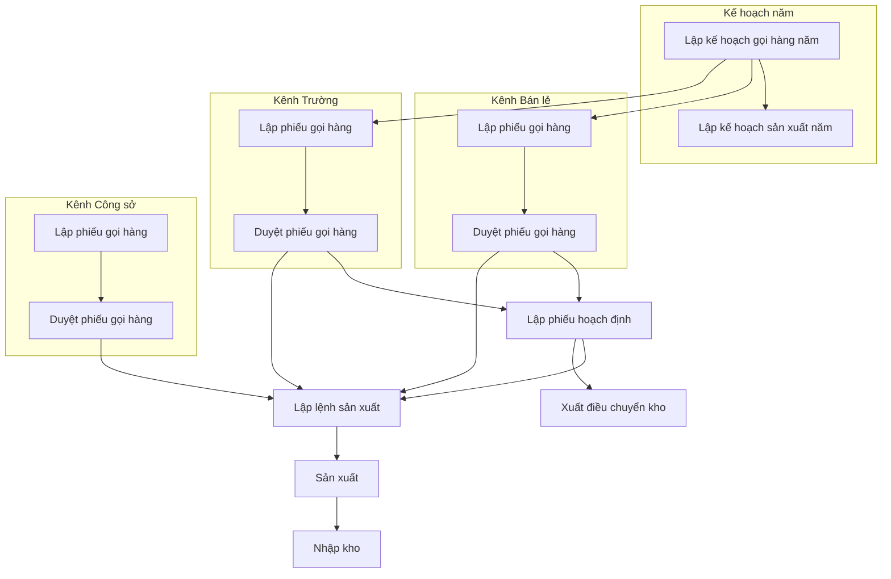

# Quy trình kế hoạch sản xuất đối chiếu source code

Nguồn ưu tiên: `D:\Project\PhuongThao\FastBusinessOnline`. Đối chiếu ngày 11/11/2026. Ghi chú họp dùng để xác định yêu cầu cải tiến, không dùng để khẳng định hệ thống đã có chức năng.

## Workflow ba kênh

Khi lập Kế hoạch sản xuất năm, lấy dữ liệu từ Kế hoạch gọi hàng năm theo xác nhận của người dùng. Source có action `goi_hang` và cột “SL KH gọi hàng”; phần xử lý lấy dữ liệu đang mã hóa nên chưa đối chiếu được câu truy vấn chi tiết. Quan hệ này độc lập với đường KHSX năm → LSX, vốn đang bị comment ở menu đã kiểm tra.

Mũi tên biểu thị quan hệ kế thừa dữ liệu hoặc chuyển trạng thái; riêng quan hệ Kế hoạch gọi hàng năm → KHSX năm được bổ sung theo xác nhận của người dùng và các khai báo liên quan trong source, không có nghĩa tự động sinh chứng từ hoặc mọi lần đều phải đi qua tất cả các bước. Các nhánh LSX trực tiếp và qua hoạch định chịu điều kiện chọn dữ liệu khác nhau. Nhánh xuất điều chuyển từ hoạch định chỉ phát sinh khi sử dụng tồn kho chung và thỏa điều kiện trong code.

## Mô tả từng bước trong workflow

STT dùng để tra cứu từng bước, không phải thứ tự bắt buộc giữa các nhánh song song. Các bước trùng tên được ghi thêm kênh để phân biệt.

| STT | Tên bước | Tên chứng từ | Mô tả mục đích và cách thực hiện |
|---|---|---|---|
| 1 | Lập kế hoạch gọi hàng năm | Kế hoạch gọi hàng năm | Xác định nhu cầu gọi hàng theo năm và kho để làm nguồn lập PGH Bán lẻ, Trường. Tạo kế hoạch, khai báo năm, kho và danh sách mặt hàng; nhập hoặc cập nhật số lượng bán năm trước, tỷ lệ tăng trưởng và số lượng kế hoạch. |
| 2 | Lập kế hoạch sản xuất năm | Kế hoạch sản xuất năm | Xác định số lượng kế hoạch sản xuất theo năm, kho và mặt hàng. Tạo kế hoạch, khai báo năm, kho, ngày và số kế hoạch; lấy dữ liệu từ Kế hoạch gọi hàng năm, kiểm tra danh sách mặt hàng và số lượng kế hoạch gọi hàng, đối chiếu tồn kho, LSX và số lượng đã gọi hàng để nhập hoặc cập nhật số lượng kế hoạch sản xuất năm. Source có màn hình này, nhưng menu lấy dữ liệu từ KHSX năm vào LSX hiện bị comment nên chưa thể hiện đường kế thừa sang LSX trong flow. |
| 3 | Lập phiếu gọi hàng — Bán lẻ | Phiếu gọi hàng bán lẻ | Ghi nhận nhu cầu hàng của kênh Bán lẻ. Tạo phiếu, khai báo thông tin gọi hàng và chi tiết mặt hàng; có thể dùng chức năng lấy số liệu từ Kế hoạch gọi hàng năm, sau đó kiểm tra và lưu phiếu để chuyển duyệt. |
| 4 | Duyệt phiếu gọi hàng — Bán lẻ | Phiếu gọi hàng bán lẻ | Xác nhận nhu cầu và số lượng được duyệt trước khi triển khai. Mở chức năng Duyệt phiếu gọi hàng bán lẻ, chọn phiếu chờ duyệt và thực hiện duyệt theo quyền; dữ liệu đủ điều kiện được chọn vào Phiếu hoạch định hoặc LSX. |
| 5 | Lập phiếu gọi hàng — Trường | Phiếu gọi hàng | Ghi nhận nhu cầu hàng của kênh Trường. Tạo phiếu, khai báo trường/khách hàng, thời điểm cần hàng và chi tiết mặt hàng; có đường lấy số liệu từ Kế hoạch gọi hàng năm. Kiểm tra và lưu phiếu để chuyển duyệt. |
| 6 | Duyệt phiếu gọi hàng — Trường | Phiếu gọi hàng | Xác nhận nhu cầu và số lượng được duyệt của kênh Trường. Mở chức năng Duyệt phiếu gọi hàng, chọn phiếu chờ duyệt và thực hiện duyệt theo quyền; dữ liệu đủ điều kiện được chọn vào Phiếu hoạch định hoặc LSX. |
| 7 | Lập phiếu gọi hàng — Công sở | Phiếu gọi hàng công sở | Ghi nhận nhu cầu sản phẩm của khách hàng Công sở. Tạo phiếu, khai báo khách hàng, ngày cần hàng và chi tiết sản phẩm; kiểm tra thông tin và lưu phiếu để chuyển duyệt. |
| 8 | Duyệt phiếu gọi hàng — Công sở | Phiếu gọi hàng công sở | Xác nhận nhu cầu và số lượng được duyệt của khách hàng Công sở. Mở chức năng Duyệt phiếu gọi hàng công sở, chọn phiếu và thực hiện duyệt theo quyền; PGH đủ điều kiện được lấy trực tiếp vào LSX. |
| 9 | Lập phiếu hoạch định | Phiếu hoạch định | Xác định cách đáp ứng nhu cầu bằng tồn kho, tồn kho chung và phần cần sản xuất thêm. Tạo phiếu, lấy dữ liệu PGH Bán lẻ/Trường đủ điều kiện, kiểm tra số lượng gọi hàng, tồn kho, phần đã hoạch định và LSX dở dang; nhập số lượng cần thêm và chạy chức năng Hoạch định sản xuất. Kết quả làm nguồn lập LSX hoặc phát sinh điều chuyển từ tồn kho chung. |
| 10 | Lập lệnh sản xuất | Lệnh sản xuất | Giao kế hoạch sản xuất cho đơn vị gia công và theo dõi số lượng cần sản xuất. Tạo LSX, khai báo thông tin đầu phiếu, chọn lấy dữ liệu từ PGH của một trong ba loại kênh hoặc từ Phiếu hoạch định; chuyển dữ liệu sang tab Chi tiết, kiểm tra số lượng sản xuất và lưu phiếu. Nguồn kế thừa phải thỏa điều kiện về trạng thái và số lượng còn lại. |
| 11 | Xuất điều chuyển kho | Phiếu xuất điều chuyển | Cấp hàng từ tồn kho chung theo kết quả hoạch định. Khi Phiếu hoạch định sử dụng tồn kho chung, được ghi nhận ở trạng thái phù hợp và thỏa điều kiện chưa có phiếu điều chuyển đã ghi nhận tương ứng, code gọi thủ tục tự sinh điều chuyển. Kiểm tra và xử lý Phiếu xuất điều chuyển được tạo theo nghiệp vụ kho. Đây là nhánh riêng từ hoạch định, không bắt buộc chờ sản xuất hoặc nhập thành phẩm. |
| 12 | Sản xuất | Lệnh sản xuất | Thực hiện sản xuất theo LSX đã lập và theo dõi tình trạng thực hiện. Sử dụng thông tin mặt hàng, số lượng và đơn vị gia công trên LSX; cập nhật trạng thái phù hợp với thực tế. Source khai báo các trạng thái Kế hoạch, Sản xuất, Hoàn thành và Đóng; bước này không được xác định là một chứng từ độc lập. |
| 13 | Nhập kho | Phiếu nhập kho | Ghi nhận thành phẩm nhận được và liên kết số lượng nhập với LSX/PGH nguồn. Tạo Phiếu nhập kho, nhập hoặc lấy dữ liệu hàng nhận vào chi tiết; tại tab Gọi hàng dùng chức năng lấy dữ liệu gọi hàng từ LSX, kiểm tra và phân bổ số lượng nhập theo các dòng nguồn rồi lưu phiếu. Trong luồng đã đối chiếu, chứng từ là Phiếu nhập kho `IRTran`, phân biệt với Phiếu nhập kho thực tế `WHTran`. |

