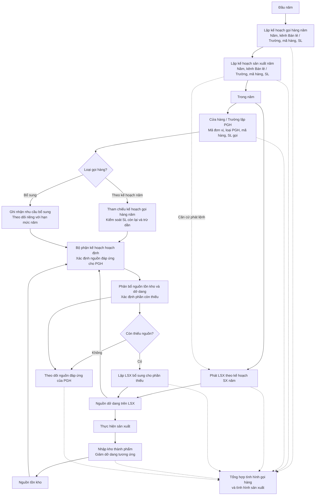
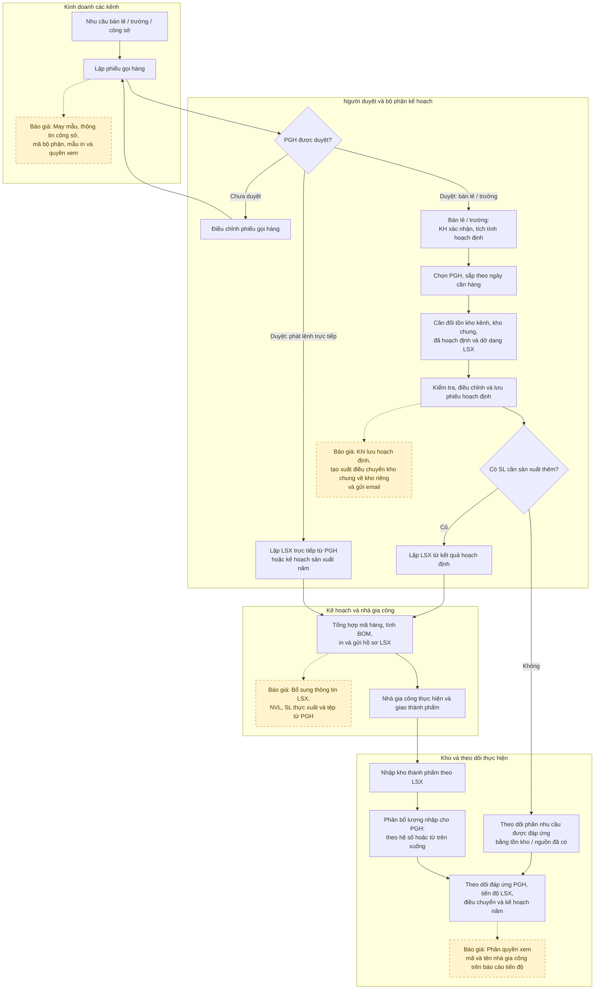
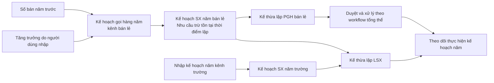
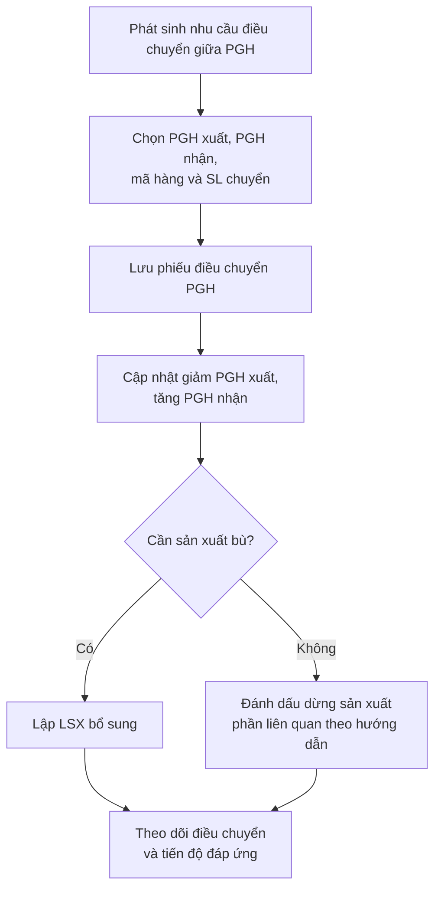

# Workflow và Business Function Diagram module kế hoạch sản xuất

**Cập nhật theo mô tả stakeholder ngày 22/10/2026:** Phần A là workflow và BFD nghiệp vụ được ưu tiên sử dụng. Phần B giữ mô hình FBO dựng từ tài liệu trước đó để đối chiếu phạm vi chức năng, không dùng thay thế yêu cầu stakeholder. Mô tả bằng lời và các quy tắc nằm trong `docs/Quy_trinh_nghiep_vu_Stakeholder.md`.

## A. Mô hình nghiệp vụ theo stakeholder

### A1. Workflow nghiệp vụ

Hai luồng chạy trong năm: gọi hàng tiêu dùng kế hoạch nhu cầu và sản xuất thực hiện kế hoạch sản xuất. Chúng gặp nhau ở bước hoạch định nguồn đáp ứng. Tồn kho và dở dang trên LSX là hai nguồn; phần chưa đủ mới dẫn đến LSX bổ sung.

Mũi tên từ dở dang sang hoạch định thể hiện dữ liệu nguồn dự kiến, không phải hàng đã sẵn sàng giao. Việc phân bổ nguồn không làm giảm lần nữa hạn mức gọi hàng năm. Nguồn đã phân bổ cần được kiểm soát để không dùng trùng cho PGH khác.

### A2. Business Function Diagram nghiệp vụ

BFD này phân rã yêu cầu stakeholder, **không gán trạng thái Nghiệm thu cho các yêu cầu chưa đối chiếu**. Trạng thái triển khai và báo giá vẫn được quản lý trong danh sách tính năng FBO và Phần B.

```mermaid
flowchart TD
    R["0. Quản lý kế hoạch gọi hàng và sản xuất"]
    R --> A["1. Quản lý kế hoạch năm"]
    A --> A1["1.1 Kế hoạch gọi hàng<br/>Bán lẻ / Trường"]
    A --> A2["1.2 Kế hoạch sản xuất<br/>Bán lẻ / Trường"]
    R --> B["2. Quản lý gọi hàng trong năm"]
    B --> B1["2.1 PGH cửa hàng bán lẻ"]
    B --> B2["2.2 PGH trường"]
    B --> B3["2.3 Phân loại theo kế hoạch / bổ sung"]
    B --> B4["2.4 Tham chiếu và trừ dần<br/>kế hoạch gọi hàng năm"]
    R --> C["3. Hoạch định nguồn đáp ứng"]
    C --> C1["3.1 Xác định nhu cầu PGH"]
    C --> C2["3.2 Xác định nguồn tồn kho"]
    C --> C3["3.3 Xác định nguồn dở dang LSX"]
    C --> C4["3.4 Phân bổ nguồn và xác định thiếu"]
    R --> D["4. Quản lý thực hiện sản xuất"]
    D --> D1["4.1 LSX theo kế hoạch năm"]
    D --> D2["4.2 LSX bổ sung do thiếu nguồn"]
    D --> D3["4.3 Theo dõi dở dang và nhập kho"]
    R --> E["5. Tổng hợp và theo dõi"]
    E --> E1["5.1 Gọi theo kế hoạch,<br/>còn lại và gọi bổ sung"]
    E --> E2["5.2 Sản xuất theo kế hoạch,<br/>bổ sung, nhập kho và dở dang"]
    E --> E3["5.3 Nguồn đáp ứng và phần thiếu<br/>của phiếu gọi hàng"]
```

### A3. Điểm cần đối chiếu khi chuyển thành đặc tả

- Kế hoạch gọi hàng năm và PGH tham chiếu kế hoạch cho kênh Trường.
- Căn cứ PGH trừ dần là kế hoạch gọi hàng; tách khỏi kế hoạch sản xuất.
- Thời điểm trừ/hoàn trả hạn mức khi lưu, duyệt, sửa hoặc hủy PGH; xử lý gọi vượt hạn mức.
- Giữ chỗ tồn kho và dở dang, chuyển nguồn khi nhập kho; không cộng phần đã hoạch định thành nguồn cung trùng.
- Phạm vi “tất cả các kênh” ngoài Bán lẻ và Trường, nếu bao gồm Công sở.
- Quy tắc ghi nhận LSX bổ sung vào báo cáo thực hiện kế hoạch sản xuất năm.

## B. Mô hình FBO từ hồ sơ để đối chiếu

Phần này dựng từ hồ sơ khảo sát 2025, HDSD 2025, HDSD luồng duyệt công sở 2026 và báo giá bổ sung 10/03/2026. Trạng thái theo quy ước người dùng: **Nghiệm thu** cho chức năng đã phát triển, **Báo giá** cho phần bổ sung. Các nút vàng và đường nét đứt chỉ phần báo giá, chưa ghép thành bước vận hành bắt buộc của hiện trạng. Những khác biệt với Phần A được ghi nhận để xác minh, không tự xem là đã đáp ứng.

## 1. Workflow tổng thể

Luồng chính: **Nhu cầu → Duyệt và xác nhận → Cân đối nguồn đáp ứng → Phát lệnh → Giao gia công → Nhập kho và phân bổ → Theo dõi**. Kế hoạch năm và phiếu gọi hàng có thể được kế thừa trực tiếp vào LSX theo HDSD; đây là các lựa chọn nghiệp vụ, không phải mọi nhu cầu đều bắt buộc qua phiếu hoạch định.

Nhà gia công thực hiện và giao thành phẩm là hoạt động nghiệp vụ ngoài hệ thống; sơ đồ không khẳng định FBO có chức năng điều độ hoặc ghi nhận từng công đoạn gia công. Nhánh phát lệnh trực tiếp không hàm ý tự động kiểm tra cân đối như phiếu hoạch định.

## 2. Workflow lập kế hoạch năm

Tất cả chức năng FBO trên sơ đồ này mang trạng thái **Nghiệm thu**. Tài liệu không mô tả kế hoạch năm công sở hoặc thuật toán tự lập kế hoạch trường. HDSD 2025 mô tả PGH bán lẻ kế thừa kế hoạch SX năm; hồ sơ khảo sát có chỗ ghi kế thừa kế hoạch gọi hàng năm, cần xác nhận lại màn hình thực tế nếu dùng làm đặc tả chi tiết.

## 3. Workflow điều chuyển giữa phiếu gọi hàng

Đây là **điều chuyển nhu cầu giữa PGH**, khác với **xuất điều chuyển kho chung về kho riêng** trong báo giá.

Nhánh sản xuất bù do người dùng quyết định và thao tác theo HSKS; không thể hiện việc phần mềm tự động quyết định hoặc tự phát lệnh bù. Chức năng trên sơ đồ mang trạng thái **Nghiệm thu** theo quy ước danh sách.

## 4. Business Function Diagram

BFD mô tả phân rã chức năng, không mô tả thứ tự thực hiện. Ký hiệu **NT = Nghiệm thu**, **BG = Báo giá**. Các chức năng cấp nhóm gom cả phần nền tảng và phần mở rộng nên không gán chung một trạng thái cho cả nhóm.

```mermaid
flowchart TD
    ROOT["0. Quản lý kế hoạch sản xuất"]
    ROOT --> F1["1. Thiết lập và dữ liệu nền"]
    ROOT --> F2["2. Quản lý kế hoạch năm"]
    ROOT --> F3["3. Quản lý nhu cầu và duyệt"]
    ROOT --> F4["4. Hoạch định thành phẩm"]
    ROOT --> F5["5. Quản lý LSX và hồ sơ gia công"]
    ROOT --> F6["6. Nhập kho và phân bổ"]
    ROOT --> F7["7. Báo cáo và kiểm soát"]

    F1 --> F11["1.1 NT: Tham số kho và email"]
    F1 --> F12["1.2 NT: Định mức BOM"]
    F1 --> F13["1.3 NT: Cấu hình luồng duyệt công sở"]

    F2 --> F21["2.1 NT: Kế hoạch gọi hàng năm"]
    F2 --> F22["2.2 NT: Kế hoạch SX năm bán lẻ / trường"]

    F3 --> F31["3.1 NT: PGH bán lẻ / trường / công sở"]
    F3 --> F32["3.2 NT: Duyệt và xác nhận PGH"]
    F3 --> F33["3.3 NT: Điều chuyển giữa PGH"]
    F3 --> F34["3.4 BG: May mẫu, thông tin công sở,<br/>mẫu in và quyền xem cấp dưới"]

    F4 --> F41["4.1 NT: Chọn PGH và xếp ưu tiên"]
    F4 --> F42["4.2 NT: Cân đối nguồn đáp ứng,<br/>tính SL cần thêm"]
    F4 --> F43["4.3 NT: Điều chỉnh và lưu hoạch định"]
    F4 --> F44["4.4 BG: Nhãn tồn kho kênh,<br/>xuất điều chuyển kho và email"]

    F5 --> F51["5.1 NT: Kế thừa nguồn và lập LSX"]
    F5 --> F52["5.2 NT: Tính BOM, in và gửi hồ sơ"]
    F5 --> F53["5.3 BG: Thông tin chi tiết LSX<br/>và cập nhật SL thực tế"]
    F5 --> F54["5.4 BG: Chỉnh sửa NVL,<br/>SL yêu cầu xuất và SL thực xuất"]
    F5 --> F55["5.5 BG: Phân biệt loại PGH,<br/>kế thừa và gửi tệp PGH"]

    F6 --> F61["6.1 NT: Nhập kho thành phẩm theo LSX"]
    F6 --> F62["6.2 NT: Phân bổ theo hệ số / thứ tự"]

    F7 --> F71["7.1 NT: Bảng kê PGH,<br/>cảnh báo quá hạn và dừng SX"]
    F7 --> F72["7.2 NT: Tiến độ LSX chi tiết / tổng hợp"]
    F7 --> F73["7.3 NT: Theo dõi điều chuyển PGH"]
    F7 --> F74["7.4 NT: Thực hiện kế hoạch năm"]
    F7 --> F75["7.5 BG: Quyền xem thông tin gia công"]

    classDef quoted fill:#fff3cd,stroke:#b8860b,color:#513c00,stroke-dasharray:5 5;
    class F34,F44,F53,F54,F55,F75 quoted;
```

### Đối chiếu BFD với danh sách tính năng

| Nhánh BFD | STT trong Danh_sach_tinh_nang_KHSX.md | Trạng thái |
|---|---|---|
| 1. Thiết lập và dữ liệu nền | 1, 2, 9 | Nghiệm thu |
| 2. Quản lý kế hoạch năm | 3, 4 | Nghiệm thu |
| 3. Quản lý nhu cầu và duyệt | 5–8, 10 | Nghiệm thu |
| 3.4 Mở rộng công sở | 20–28 | Báo giá |
| 4. Hoạch định thành phẩm | 11, 12 | Nghiệm thu |
| 4.4 Điều chuyển kho và thông báo | 29–31 | Báo giá |
| 5. Quản lý LSX và hồ sơ gia công | 13, 14 | Nghiệm thu |
| 5.3–5.5 Mở rộng LSX | 32–38 | Báo giá |
| 6. Nhập kho và phân bổ | 15 | Nghiệm thu |
| 7. Báo cáo và kiểm soát | 16–19 | Nghiệm thu |
| 7.5 Quyền xem gia công | 39 | Báo giá |

## 5. Các điểm chưa đủ căn cứ để đưa thành chức năng

- Chưa khẳng định công sở/may mẫu chạy chung thuật toán hoạch định bán lẻ và trường.
- Chưa đưa vào chức năng lập lịch theo năng lực chuyền/nhà gia công, hoạch định NVL và đề xuất mua vì nguồn chưa mô tả đầy đủ.
- Chưa mô tả tự động sửa/hủy chứng từ điều chuyển khi sửa/hủy hoạch định vì báo giá chưa nêu quy tắc này.
- Luồng từ nhu cầu đến sản xuất bù và theo dõi là mô hình nghiệp vụ dựng lại; quyền thao tác chi tiết, điều kiện khóa chứng từ và chuyển trạng thái cần xác nhận trước khi chuyển thành đặc tả triển khai.

## Nguồn đối chiếu

1. `input/HSKS.2025.PHUONGTHAO_Final.docx`: Kế hoạch năm; PGH; Điều chuyển; Nhập kho; LSX; Hoạch định; Báo cáo.
2. `input/HDSD.2025.PHUONGTHAO.docx`: Kế hoạch năm; PGH và duyệt; LSX; Nhập kho; Phiếu hoạch định; Báo cáo.
3. `input/HDSD.2026. Khai báo luồng duyệt PGH công sở.docx`: Cấu hình kiểu duyệt, quyền duyệt và người duyệt.
4. `input/Báo giá bổ sung tính năng phần mềm Fast Business Online_Công ty Đồng Phục Phương Thảo_QLSX.doc`: Bốn nhóm bổ sung ngày 10/03/2026.
5. `docs/Danh_sach_tinh_nang_KHSX.md`: Danh sách 39 mục và trạng thái theo yêu cầu người dùng.
