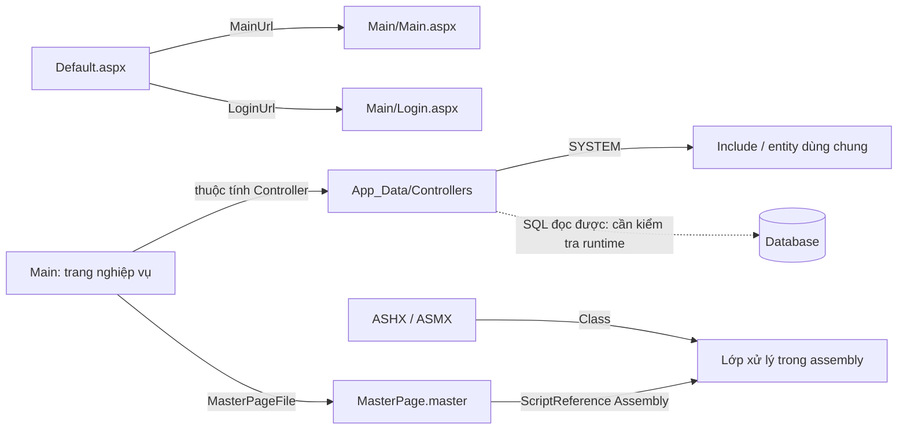

# Bản đồ mã nguồn FastBusinessOnline

Source: `D:\Project\PhuongThao\FastBusinessOnline`. Ngày khảo sát: 11/11/2026.

## Tra cứu nhanh

| Cần tìm | Mở chỉ mục |
|---|---|
| Tên chức năng tiếng Việt → trang ASPX → Controller | [Màn hình](screens.md) |
| Controller → Dir / Filter / Grid / Report và các nhóm khác | [Controller](controllers.md) |
| Bảng khai báo hoặc tên gọi EXEC → vị trí tệp, dòng | [Tham chiếu dữ liệu](data-references.md) |
| ASHX / ASMX → lớp xử lý | [Endpoint](endpoints.md) |
| Kế hoạch sản xuất, MPS, MRP | [Bản đồ KHSX](khsx.md) |
| Thống kê loại tệp | [Thống kê](inventory.md) |
| Tra cứu tự động, gồm include và số dòng | [Chỉ mục JSON](index.json) |

Mở chỉ mục và dùng Ctrl+F theo tên nghiệp vụ, mã Controller hoặc bảng. Liên kết source dùng đường dẫn tuyệt đối; liên kết tham chiếu dữ liệu có số dòng.

## Cấu trúc đã quan sát

Đây là cây website ASP.NET Web Forms dùng các lớp FastBusiness và khai báo `Language="vb"`. Khảo sát chưa thấy `.sln`, `.csproj`, `.vbproj`, `.cs` hoặc `.vb`. Nhiều chức năng khai báo bằng XML / `.f`; lớp nền tảng nằm trong `bin/*.dll`. Vì vậy bản đồ này mô tả mã và cấu hình đọc được, chưa bao phủ phần triển khai bên trong DLL hoặc database.

| Vị trí | Vai trò và bằng chứng |
|---|---|
| `Default.aspx` | Khai báo `FastBusiness.MenuExtender.DefaultPage`, MainUrl và LoginUrl |
| `Global.asax` | Khai báo application `FastBusiness.LoginExtender.Sky` |
| `Main/*.aspx` | Trang nghiệp vụ; nhiều trang gắn `FastBusiness:ReportExtender` với `Controller` |
| `Main/MasterPage.master` | Khung dùng chung, ScriptManager và script từ assembly |
| `App_Data/Controllers/Dir` | Khai báo biểu mẫu/danh mục/chứng từ; ví dụ `MRPProductionPlanning.f` có table, fields, entity SQL |
| `Filter`, `Grid`, `Report` | Các khai báo bộ lọc, lưới, báo cáo; đối chiếu tên Controller và tham chiếu thực tế |
| `Include` | Entity, XML và JavaScript dùng lại qua `SYSTEM` |
| `Lookup`, `Flow` | Khai báo tra cứu, sơ đồ chức năng; có `Flow/MPS.xml`, `Flow/MRP.xml` |
| `Templates/Upload` | Quy tắc nhập, ánh xạ cột Excel, bảng đích |
| `Templates/Excel`, `Templates/Rpt` | Mẫu Excel, RPT, XSD; chỉ thống kê tên/loại, chưa phân tích nội dung nhị phân |
| `AppHandler`, `AppService` | Điểm vào HTTP, khai báo Class của handler / web service |
| `ClientScript`, `Css`, `Images` | Tài nguyên giao diện; một phần JavaScript còn ở entity và assembly |
| `bin` | DLL FastBusiness, Voucher, Import, Flow, thư viện ngoài |
| `Web.config` | Cấu hình website; không đưa giá trị cấu hình vào chỉ mục |



Mũi tên nét đứt là quan hệ suy ra từ mã SQL, chưa xác nhận bằng chạy hệ thống. Không coi mọi tệp cùng tên ở các nhóm là chắc chắn được framework nạp cùng lúc.

## Quy trình lần theo một chức năng

1. Tìm tên tiếng Việt trong `screens.md`; ghi lại trang và Controller.
2. Tìm Controller ở các chỉ mục Dir, Filter, Grid và Report. Kiểm tra cả `.f` lẫn `.xml`, không tự coi một bản là dư thừa.
3. Đọc khai báo fields, table/baseTable, command và clientScript trong source. Có tệp chứa `<Encrypted>` nên chỉ mục đánh dấu riêng.
4. Lần theo `SYSTEM` và thuộc tính controller. JSON lưu các tham chiếu cùng số dòng; đường dẫn SYSTEM được giữ nguyên, chưa tự phân giải theo cơ chế runtime của FastBusiness.
5. Tìm ngược tên bảng hoặc EXEC trong `data-references.md`; mở tệp để kiểm tra ngữ cảnh.
6. Nếu chạm Class từ ASMX/ASHX hoặc tên stored procedure không có định nghĩa, cần bộ source thư viện/database tương ứng để kết luận sâu hơn.

## Tìm trực tiếp bằng PowerShell và ripgrep

```powershell
$src = 'D:\Project\PhuongThao\FastBusinessOnline'
# Theo tên nghiệp vụ
rg -n -i --glob '*.aspx' 'kế hoạch sản xuất' "$src\Main"
# Theo Controller; tìm cả khai báo và lời gọi
rg -n -i --glob '*.aspx' --glob '*.f' --glob '*.xml' 'MRPProductionPlanning' "$src\Main" "$src\App_Data\Controllers"
# Theo bảng hoặc thủ tục, thêm glob txt/ent vì SQL có thể nằm trong entity
rg -n -i --glob '*.f' --glob '*.xml' --glob '*.ent' --glob '*.txt' --glob '*.sql' '\bmctkhsx\b' "$src\App_Data\Controllers"
# Lọc nhanh chỉ mục máy đọc
$idx = Get-Content -Raw -Encoding utf8 '.\docs\code-map\index.json' | ConvertFrom-Json
$idx.records | Where-Object { $_.path -match 'MPS|MRP|zvkhsanxuatnam' } | Select-Object path,title
```

## Cập nhật và giới hạn

Chạy từ workspace tài liệu:

```powershell
python .\tools\build_code_map.py
# Hoặc chỉ rõ một bản source khác
python .\tools\build_code_map.py --source 'D:\Project\PhuongThao\FastBusinessOnline'
```

Script chỉ đọc source, ghi các chỉ mục sinh tự động vào `docs/code-map/`; giữ nguyên README và `khsx.md` biên soạn thủ công. Chỉ mục là ảnh chụp tại thời điểm chạy, không tự đồng bộ khi source thay đổi.

Trích xuất dùng regex, không thực thi XML entity, SQL, JavaScript hay DLL. Tên EXEC có thể lấy từ comment hoặc chuỗi; table/baseTable chỉ phản ánh thuộc tính khai báo, không liệt kê đầy đủ bảng trong JOIN/SQL động. Chưa xác nhận menu/phân quyền, màn hình đang được sử dụng, kết nối database, quan hệ khóa hoặc luồng runtime. Không suy ra trạng thái Nghiệm thu/Báo giá từ việc có tệp source.

Chỉ mục bỏ qua nội dung `Web.config`, License, Upload, Send, tệp nén và nhị phân. Không sao chép payload mã hóa. JSON chỉ lưu metadata và tham chiếu; một số tệp không UTF-8 được đọc dự phòng bằng cp1258 và có ghi encoding để kiểm tra khi tên hiển thị sai.
